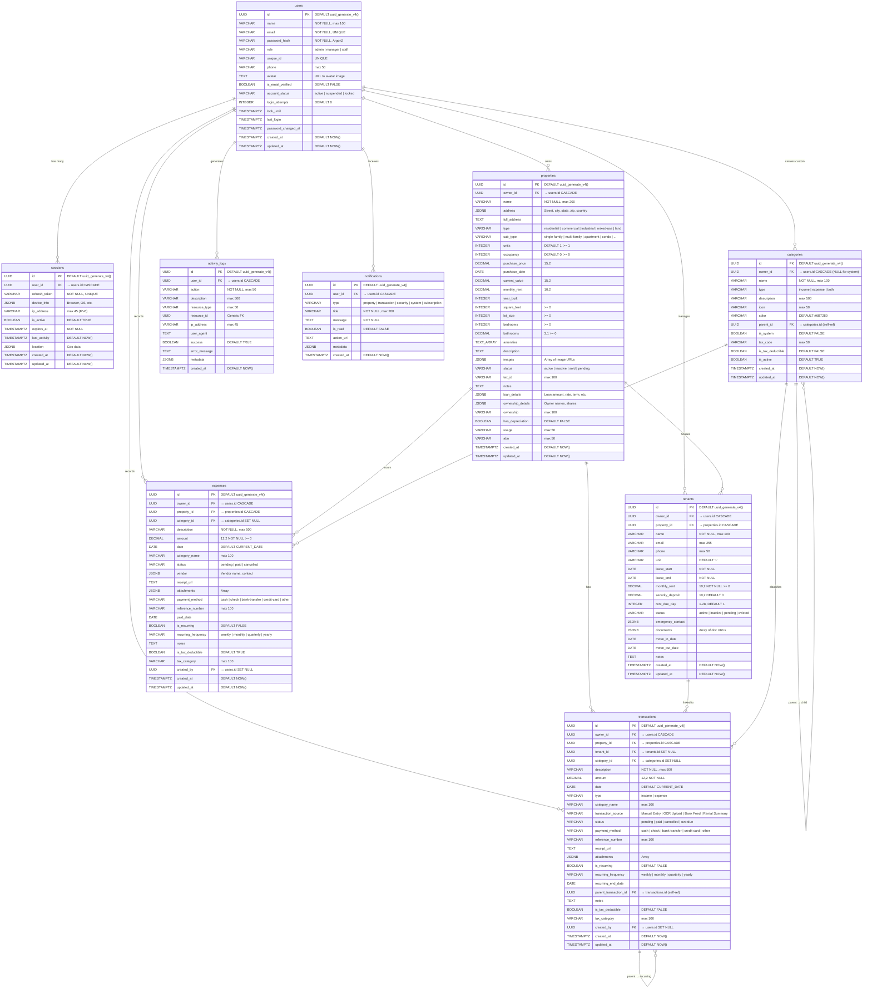
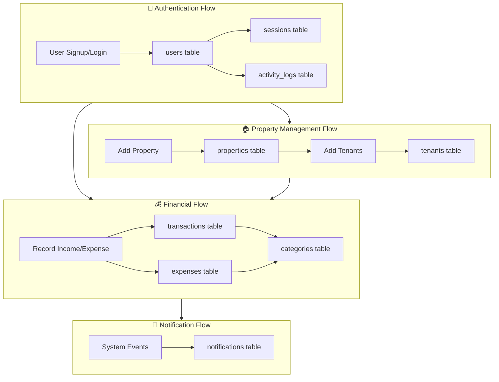
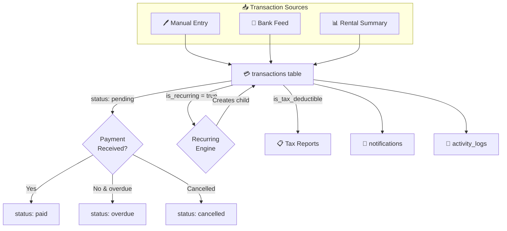
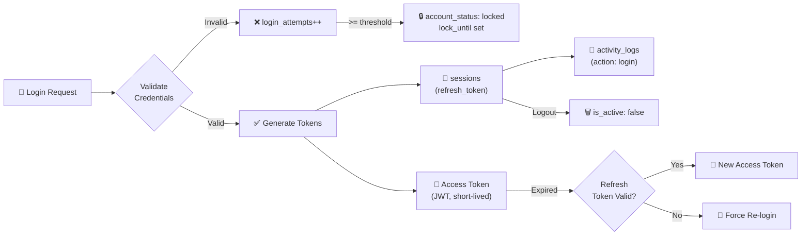

# 🗄️ Properly — Database ER Diagram & Data Flow

> **Generated:** 2026-02-13  
> **Database:** PostgreSQL (Supabase)  
> **Total Tables:** 9  
> **Schema File:** `all-in-one.sql`

---

## 📊 Entity-Relationship Diagram



---

## 📋 Table Metadata

| # | Table | Purpose | Row Growth | Has `updated_at` Trigger |
|---|-------|---------|------------|--------------------------|
| 1 | `users` | User accounts, auth, roles | Low (staff count) | ✅ |
| 2 | `sessions` | JWT refresh tokens, device tracking | Medium (per login) | ✅ |
| 3 | `properties` | Real estate portfolio | Low–Medium | ✅ |
| 4 | `categories` | Income/expense classification | Low (mostly system) | ✅ |
| 5 | `tenants` | Lease & tenant records | Medium | ✅ |
| 6 | `transactions` | All income & expense entries | **High** | ✅ |
| 7 | `expenses` | Standalone expense records | **High** | ✅ |
| 8 | `activity_logs` | Audit trail (login, CRUD ops) | **Very High** | ❌ (append-only) |
| 9 | `notifications` | In-app alerts & messages | **High** | ❌ (append-only) |

---

## 🔑 Relationship Summary

### Foreign Key Map

```
users.id
 ├── sessions.user_id              (CASCADE)
 ├── properties.owner_id           (CASCADE)
 ├── categories.owner_id           (CASCADE)
 ├── tenants.owner_id              (CASCADE)
 ├── transactions.owner_id         (CASCADE)
 ├── transactions.created_by       (SET NULL)
 ├── expenses.owner_id             (CASCADE)
 ├── expenses.created_by           (SET NULL)
 ├── activity_logs.user_id         (CASCADE)
 └── notifications.user_id         (CASCADE)

properties.id
 ├── tenants.property_id           (CASCADE)
 ├── transactions.property_id      (CASCADE)
 └── expenses.property_id          (CASCADE)

tenants.id
 └── transactions.tenant_id        (SET NULL)

categories.id
 ├── categories.parent_id          (SET NULL)  ← self-referential
 ├── transactions.category_id      (SET NULL)
 └── expenses.category_id          (SET NULL)

transactions.id
 └── transactions.parent_transaction_id  (SET NULL)  ← self-referential (recurring)
```

### On Delete Behavior

| Behavior | Meaning | Used For |
|----------|---------|----------|
| `CASCADE` | Delete children when parent is deleted | Core ownership (user→properties, property→tenants) |
| `SET NULL` | Nullify FK when parent is deleted | Optional references (tenant on transaction, category on expense) |

---

## 🔄 Data Flow Diagram



---

## 🔄 Detailed Data Flow: Transaction Lifecycle



---

## 🔄 Detailed Data Flow: Authentication & Sessions



---

## 📐 Index Coverage

| Table | Indexed Columns | Purpose |
|-------|----------------|---------|
| `users` | `email`, `unique_id` | Fast login lookup, unique ID search |
| `sessions` | `user_id`, `refresh_token`, `expires_at`, `is_active` | Token validation, cleanup |
| `properties` | `owner_id`, `status` | Owner portfolio, status filters |
| `categories` | `type`, `owner_id`, `is_system` | Category listings |
| `tenants` | `owner_id`, `property_id`, `status`, `email` | Tenant search & filters |
| `transactions` | `owner_id`, `property_id`, `tenant_id`, `date DESC`, `(type, status)` | Financial queries, date-range reports |
| `expenses` | `owner_id`, `property_id`, `date DESC`, `status` | Expense reporting |
| `activity_logs` | `user_id`, `action`, `created_at DESC` | Audit trail queries |
| `notifications` | `user_id`, `is_read`, `created_at DESC` | Notification feed |

---

> **💡 Tip:** To render this diagram, open this file in **GitHub**, **VS Code** (with Mermaid extension), or paste into [mermaid.live](https://mermaid.live).
